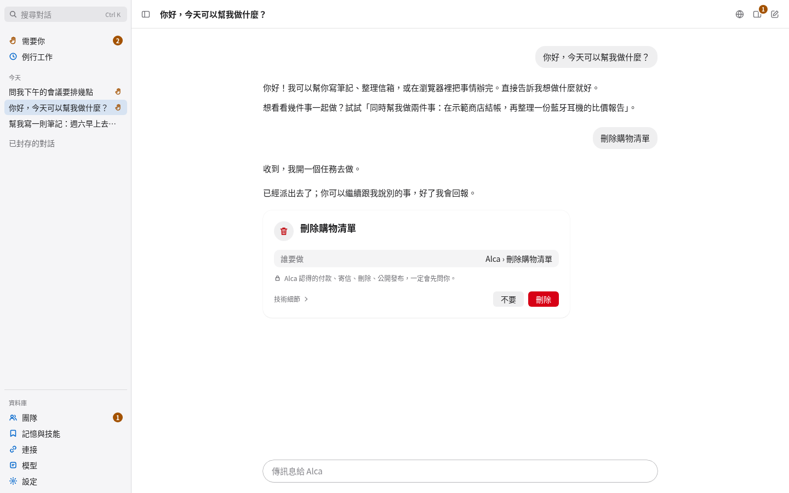
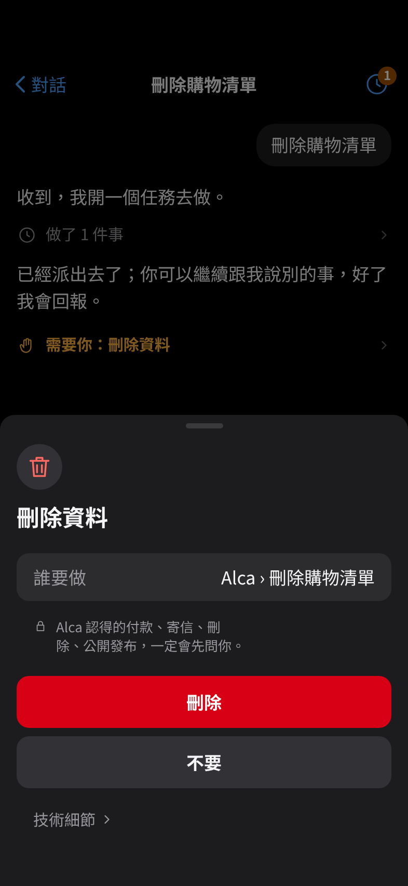
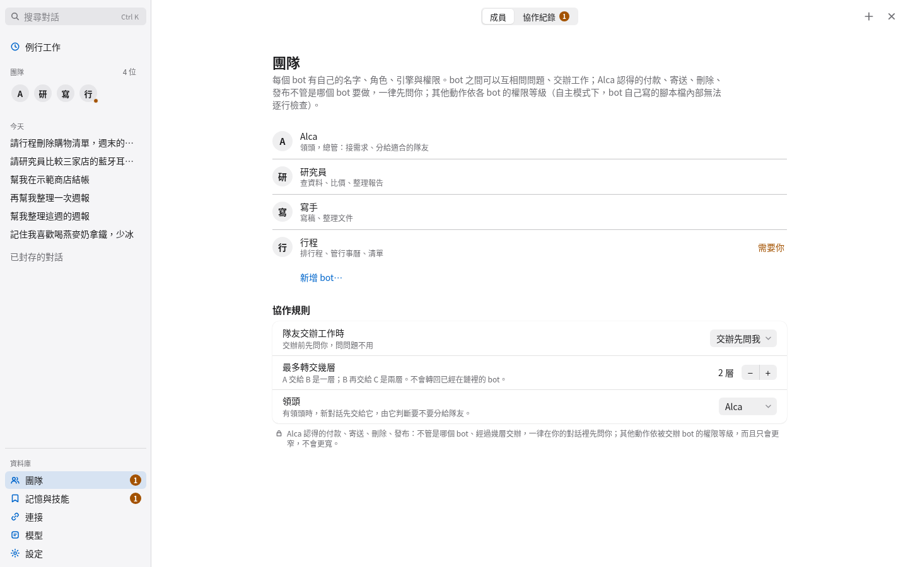
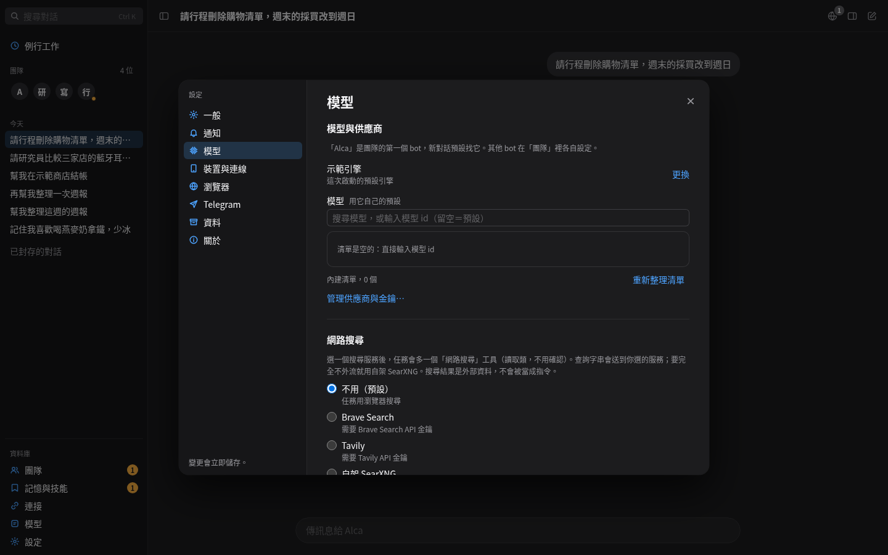
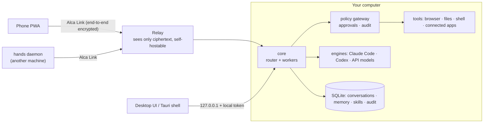

# Alca

[繁體中文](README.md) · **English**

Alca is a personal AI agent that runs on your own computer. It can hold conversations, write code, drive a
browser, read and act in the apps you connect, and remember your preferences — while everything it keeps
(conversations, memory, keys) stays on your machine. Paying, sending, deleting and publishing always ask you
first; no setting can skip that. Your phone connects back through a web app (PWA) over the end-to-end encrypted
**Alca Link**; the relay in between only ever sees ciphertext, and you can host it yourself.

Alca's interface is Traditional Chinese first, with an English translation.

> **Status: pre-1.0, not yet released.** `v0.2.0` exists as a draft release; everything since is on `main`. The
> code has a large automated test suite, but many parts have only been checked against fakes (fake engines, fake
> CLIs, a headless browser) and may still misbehave on real devices. See [docs/ROADMAP.md](docs/ROADMAP.md) for
> what is not verified yet.

<p>
  
  
</p>

## Features

- **Local first**: the core binds only to `127.0.0.1` and keeps its state in one SQLite file; conversation
  content can be encrypted per column, with the key in the system keychain (macOS Keychain).
- **Router and workers**: each bot has a router that talks to you and dispatches work to parallel workers. Workers
  run under a `coding` or `general` harness with a budget, done-conditions, host-run verification and an optional
  independent reviewer.
- **One safety gate**: every action goes through the same policy gateway (decide → audit → execute) with a
  hash-chained audit log; pay / send / delete / publish always need your yes; optional OS sandbox (macOS
  Seatbelt, Linux bubblewrap).
- **Many engines**: Claude Code CLI, Codex CLI, OpenAI-compatible APIs, OpenAI, Anthropic, Gemini, OpenRouter,
  ACP agents, and an offline demo engine that needs no model.
- **Alca Browser**: Alca's own Chromium that you can take over at any time; sensitive steps show a confirmation
  card first.
- **Memory and skills**: remembers what you told it (with its source, editable, forgettable), learns skills from
  work it has done, notices what is coming up and offers to help.
- **Connected apps and routines**: Gmail, calendars and more through your own Composio account or your own MCP
  servers; scheduled or triggered routines.
- **Phone**: chat, approvals, the live browser view, an offline outbox, push notifications; pair with a code or a
  Google account.
- **Team**: several bots, each with its own engine and rules, delegating to each other (permissions only narrow).
- **Desktop app**: a Tauri 2 shell (menu-bar icon, open at login), the `alca` command, an always-on service and
  `alca update`.

<p>
  
  
</p>

## Architecture



Module map, trust boundaries and the data flow of one turn: [docs/ARCHITECTURE.md](docs/ARCHITECTURE.md).
Protocol: [docs/PROTOCOL.md](docs/PROTOCOL.md). Security model: [docs/SECURITY.md](docs/SECURITY.md).

## Repository layout

| Path                                                                                                                           | What it holds                                                                                                |
| ------------------------------------------------------------------------------------------------------------------------------ | ------------------------------------------------------------------------------------------------------------ |
| `apps/desktop`                                                                                                                 | Local server, desktop web UI, the `alca` command and the always-on service                                   |
| `apps/desktop-shell`                                                                                                           | Tauri 2 desktop shell (Rust): window, menu bar, open at login, `alca://` links                               |
| `apps/phone-pwa`                                                                                                               | The phone web app                                                                                            |
| `apps/hands`                                                                                                                   | Daemon that runs commands for the agent on another machine                                                   |
| `packages/protocol`                                                                                                            | Alca Event Protocol (zod as the single source → types, validators, `spec/` JSON Schema)                      |
| `packages/core`                                                                                                                | Turn pipeline, router and workers, worker harness, proactive offers, care moments                            |
| `packages/engines`                                                                                                             | Engine interface and engines, provider catalog, MCP tool bridge                                              |
| `packages/policy`                                                                                                              | Policy gateway and approvals                                                                                 |
| `packages/store`                                                                                                               | SQLite, migrations, audit, column encryption, CJK full-text search                                           |
| `packages/memory`                                                                                                              | Memory, learning, skills                                                                                     |
| `packages/browser`                                                                                                             | Alca Browser                                                                                                 |
| `packages/link`                                                                                                                | Alca Link (PAKE pairing, signed sessions, sealed frames, WebRTC)                                             |
| `packages/connectors`                                                                                                          | Composio and MCP server connections                                                                          |
| `packages/tools` `packages/jobs` `packages/config` `packages/os` `packages/push` `packages/channel-telegram` `packages/design` | Tool registry, jobs and scheduling, settings schema, keychain and sandbox, Web Push, Telegram, design tokens |
| `packages/evals`                                                                                                               | Safety and behaviour scenarios run against fake engines                                                      |
| `services/rendezvous`                                                                                                          | Self-hostable relay (Node)                                                                                   |
| `services/relay-worker`                                                                                                        | The same relay on Cloudflare Workers                                                                         |
| `spec/`                                                                                                                        | Generated protocol JSON Schemas                                                                              |
| `scripts/`                                                                                                                     | Installers, packing, CI checks, benchmarks                                                                   |
| `docs/`                                                                                                                        | Documentation; index in [docs/README.md](docs/README.md)                                                     |

## Install

You need **Node.js 22.18 or later** (the macOS and Linux desktop apps bring their own).

> Until the first release is published, GitHub's "latest" does not see the draft release: name the version when
> downloading, for example `--version v0.2.0`.

**macOS desktop app** (one line in Terminal, no Gatekeeper prompt):

```sh
curl -fsSL https://github.com/ihsieh31/alca-bot/releases/latest/download/install.sh | bash -s -- --app-only
```

It downloads `Alca-macos.app.tar.gz`, checks its SHA-256 and code signature, and installs `~/Applications/Alca.app`.
You can also download the `.dmg` from the release page; the first open of a build that is not notarized needs
System Settings → Privacy & Security → "Open Anyway".

**macOS / Linux always-on core** (installs into `~/.alca` and starts at login with launchd / systemd `--user`):

```sh
curl -fsSL https://github.com/ihsieh31/alca-bot/releases/latest/download/install.sh | bash
# common options: --version <tag> · --engine claude-code|demo · --no-service · -- <core flags, e.g. --rendezvous https://your.relay>
```

On Linux the release also has `.deb` and `.AppImage` desktop apps.

**Windows**: install Node.js 22.18 or later, download `install.ps1` from the release, and run in PowerShell:

```powershell
powershell -ExecutionPolicy Bypass -File .\install.ps1 --version v0.2.0
```

Like `install.sh`, it checks the SHA-256, installs into `~\.alca` and starts the core at logon with Task Scheduler.
The desktop app is the release's `.exe` (on Windows it needs the core installed first).

**From source**:

```sh
git clone https://github.com/ihsieh31/alca-bot.git && cd alca-bot
corepack enable && pnpm install
bash scripts/install.sh --local .
```

Then open `http://127.0.0.1:4317` (or the desktop app). Everyday commands: `alca service status`, `alca pair`,
`alca open`, `alca update check | install | rollback`, `alca db backup`. Every option:
[docs/RUNNING.md § 11–12](docs/RUNNING.md#11-desktop-shell-p8).

## Pairing a phone

The phone reaches your computer through a relay it can reach over TLS (the relay only forwards ciphertext):

1. **Relay**: a release build that carries the official endpoints needs no setup. Otherwise host one: build the
   phone site with `node --disable-warning=ExperimentalWarning apps/phone-pwa/scripts/build.ts`, then run
   `pnpm rendezvous --pwa apps/phone-pwa/dist` (Node, behind your TLS reverse proxy), or deploy
   `services/relay-worker` to Cloudflare Workers. Steps: [docs/RUNNING.md § 7](docs/RUNNING.md#7-alca-link-phone--hands-p4)
   and [docs/DEPLOY.md](docs/DEPLOY.md). Then enter the URL under Settings → Devices & connection → Change site
   and relay… (設定 → 裝置與連線 → 變更網站與中繼站…) on the desktop, or start the core with `--rendezvous https://…`.
2. **Pair**: on the desktop choose Settings → Devices & connection → Pair a new phone…, or run `alca pair`, for a
   pairing code and QR code. On the phone,
   open the relay's URL, type the code or scan the QR, and compare the safety number on both screens.
3. **iPhone**: first add the page to the Home Screen (Safari → Share → Add to Home Screen) and **pair from the
   Home Screen app** — it keeps its storage apart from Safari, and push notifications only work there.
4. **With a Google account**: if the phone site and Google sign-in are deployed, sign in with Google under Settings →
   Devices & connection on the computer, sign in on the phone with the same account, and type the phone's 6-digit code on
   the computer once ([docs/DEPLOY.md](docs/DEPLOY.md)).

## Models and providers

Open **模型** (Models and providers) in the sidebar:

- **CLI providers** (Claude Code, Codex CLI, Gemini CLI, OpenCode): log in to the CLI yourself in a terminal; Alca
  never sees that login.
- **API providers** (OpenAI, OpenRouter, Anthropic, Gemini and more): paste an API key. It is kept in the local
  encrypted vault and never shown again.
- **Custom providers**: an ACP agent, or any OpenAI- / Anthropic-compatible service (base URL + key + models).
- Each bot picks its provider and model under 團隊 → 編輯 → 進階 (Team → Edit → Advanced).

To look around without a model, start with `--engine demo` (the offline demo engine). Every provider in detail:
[docs/PROVIDERS.md](docs/PROVIDERS.md).

## Development

You need Node.js 22.18 or later and pnpm 12 (the exact version is `packageManager` in `package.json`;
`corepack enable` picks it up).

```sh
pnpm install
pnpm desktop:demo     # start with the offline demo engine; open the URL it prints
pnpm test             # all tests (vitest)
pnpm check            # every check a pull request must pass (below)
pnpm format           # biome formatting
```

`pnpm check` runs, in order:

| Command                    | Checks                                                                        |
| -------------------------- | ----------------------------------------------------------------------------- |
| `pnpm typecheck`           | TypeScript (core, desktop UI, phone PWA)                                      |
| `pnpm lint`                | biome (code and Markdown)                                                     |
| `pnpm check:size`          | no source file over 800 lines                                                 |
| `pnpm check:deploy-values` | no deployment-specific values (domains, client IDs, keys) in the code         |
| `pnpm check:versions`      | one version across the packages, Tauri and Cargo                              |
| `pnpm check:names`         | no studied project's names ([clean-room rules](docs/CLEANROOM.md))            |
| `pnpm check:prompt-budget` | fixed prompts and tool specs stay within `scripts/prompt-budget.json`         |
| `pnpm check:i18n`          | no new hard-coded Chinese in the UI; the 繁中 and English string tables agree |
| `pnpm spec:check`          | `spec/` JSON Schemas match the protocol code (`pnpm spec:gen` regenerates)    |
| `pnpm test`                | unit, integration and end-to-end tests                                        |

There is also `pnpm evals` (safety and behaviour scenarios against fake engines) and `pnpm smoke` (opt-in smoke
tests against real accounts; runs only the blocks whose `ALCA_SMOKE_*` variables you set). Some tests start a
headless Chromium; they skip when none is installed and always run in CI. More ways to run Alca:
[docs/RUNNING.md](docs/RUNNING.md). Manual checks on real devices: [docs/DEVICE-TEST.md](docs/DEVICE-TEST.md).

## Contributing

Issues and pull requests are welcome. Read [CONTRIBUTING.md](CONTRIBUTING.md) first; everyone follows the
[Code of Conduct](CODE_OF_CONDUCT.md). User-facing text is Traditional Chinese first; docs are in English.

**Please report security problems privately**, as described in [SECURITY.md](SECURITY.md), not in a public issue.

## License

[Apache License 2.0](LICENSE). Third-party components: [NOTICE](NOTICE) and
[THIRD_PARTY_NOTICES.md](THIRD_PARTY_NOTICES.md).
