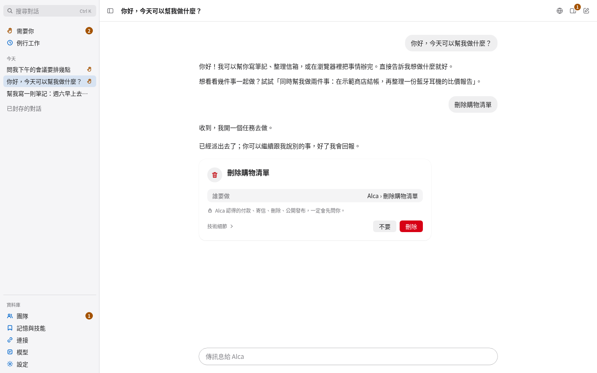
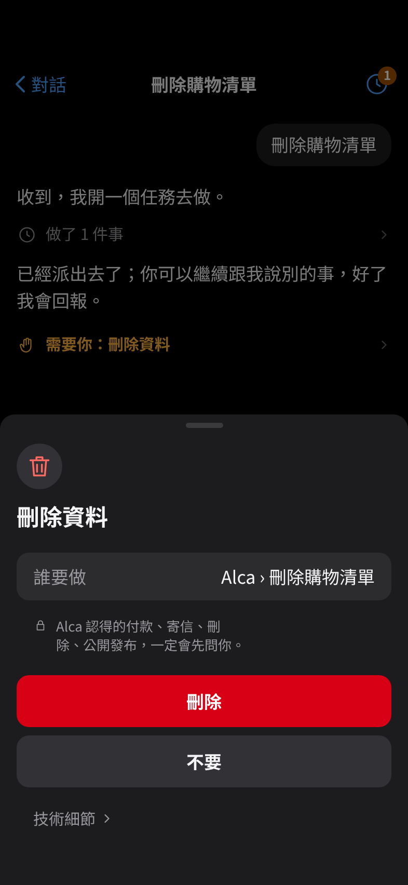
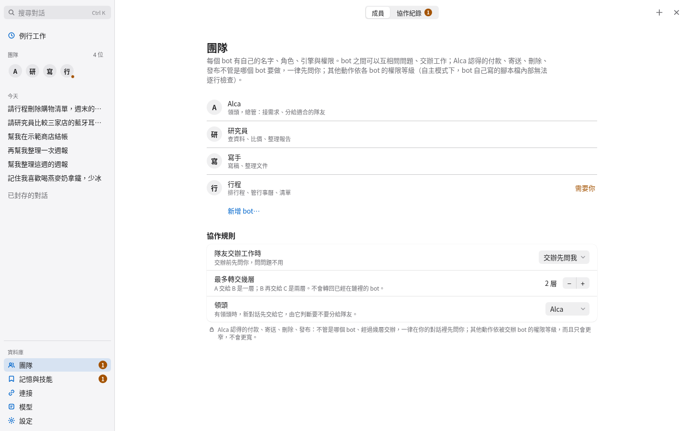
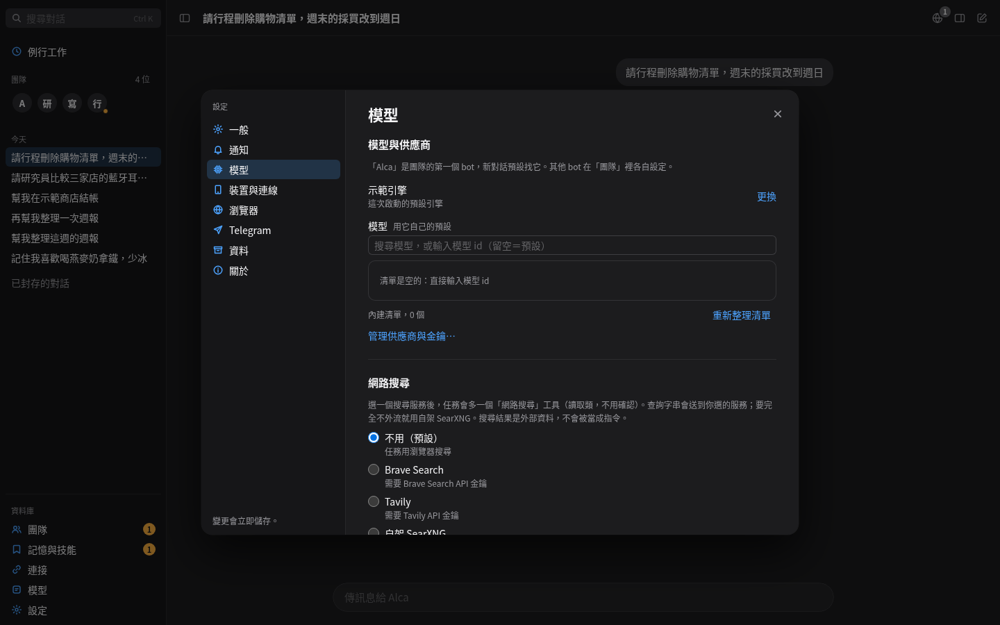
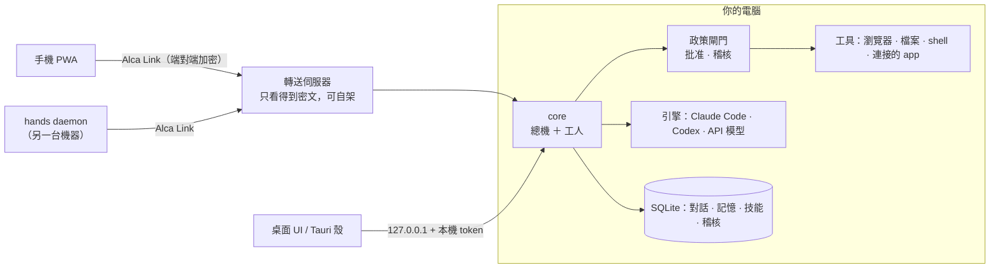

# Alca

**繁體中文** · [English](README.en.md)

Alca 是跑在你自己電腦上的個人 AI agent。它可以幫你處理對話、寫程式、操作瀏覽器、讀寫你連接的 app，並記得你的偏好；
所有資料（對話、記憶、金鑰）都留在你的電腦裡。付款、寄信、刪除、公開發布這四類動作一律先問你，沒有任何設定可以略過。
手機用網頁 app（PWA）經端對端加密的 **Alca Link** 連回你的電腦，中間的轉送伺服器只看得到密文，也可以自己架。

> **狀態：pre-1.0，尚未正式發布。** `v0.2.0` 目前是 draft release；之後的功能都在 `main` 上。程式有完整的自動化測試，
> 但很多部分只在模擬環境（假引擎、假 CLI、無頭瀏覽器）驗證過，真機上可能還有問題。
> 哪些還沒驗證見 [docs/ROADMAP.md](docs/ROADMAP.md)。

<p>
  
  
</p>

## 功能

- **本機優先**：核心只綁 `127.0.0.1`，狀態存在一個 SQLite 檔；對話內容可欄位加密，金鑰放在系統鑰匙圈（macOS Keychain）。
- **總機 ＋ 工人**：每個 bot 有一個負責對話與派工的總機，工作交給平行執行的工人，分「程式」與「一般」兩種 harness，
  有預算、完成條件、主機端驗證與可選的獨立審查。
- **安全閘門**：所有動作都經過同一個政策閘門（判斷 → 稽核 → 執行），稽核紀錄是雜湊鏈；
  付款／寄信／刪除／發布永遠要你點頭；可選 OS 沙箱（macOS Seatbelt、Linux bubblewrap）。
- **多種引擎**：Claude Code CLI、Codex CLI、OpenAI 相容 API、OpenAI、Anthropic、Gemini、OpenRouter、ACP agent，
  以及不需要模型的離線示範引擎。
- **Alca Browser**：Alca 自己的 Chromium，可隨時「接手」，敏感操作會先跳確認卡。
- **記憶與技能**：記得你說過的事（附來源、可編輯、可忘記），從做過的事學成技能；主動留意（例如快到期的事）並提出建議。
- **連接 app 與例行工作**：透過你自己的 Composio 帳號或 MCP 伺服器連接 Gmail、日曆等；排程或觸發的例行工作。
- **手機**：聊天、核准、看瀏覽器畫面、離線佇列、推播通知；用配對碼或 Google 帳號配對。
- **團隊**：多個 bot 各有自己的引擎與規則，可以互相交辦（權限只會變窄）。
- **桌面 app**：Tauri 2 桌面殼（選單列圖示、開機啟動）、`alca` 指令、常駐服務、`alca update` 更新。

<p>
  
  
</p>

## 架構



詳細的模組關係、信任邊界與一個回合的資料流見 [docs/ARCHITECTURE.md](docs/ARCHITECTURE.md)；
協定見 [docs/PROTOCOL.md](docs/PROTOCOL.md)，安全模型見 [docs/SECURITY.md](docs/SECURITY.md)。

## 專案結構

| 路徑                                                                                                                           | 內容                                                                                  |
| ------------------------------------------------------------------------------------------------------------------------------ | ------------------------------------------------------------------------------------- |
| `apps/desktop`                                                                                                                 | 本機伺服器、桌面 Web UI、`alca` 指令與常駐服務                                        |
| `apps/desktop-shell`                                                                                                           | Tauri 2 桌面殼（Rust）：視窗、選單列、開機啟動、`alca://` 連結                        |
| `apps/phone-pwa`                                                                                                               | 手機網頁 app                                                                          |
| `apps/hands`                                                                                                                   | 在另一台機器上替 agent 執行指令的 daemon                                              |
| `packages/protocol`                                                                                                            | Alca Event Protocol（zod 單一來源 → 型別、驗證器、`spec/` 的 JSON Schema）            |
| `packages/core`                                                                                                                | 回合 pipeline、總機與工人、worker harness、主動留意、關心時刻                         |
| `packages/engines`                                                                                                             | 引擎介面與各引擎、供應商清單、MCP 工具橋接                                            |
| `packages/policy`                                                                                                              | 政策閘門與批准                                                                        |
| `packages/store`                                                                                                               | SQLite、migrations、稽核、欄位加密、CJK 全文搜尋                                      |
| `packages/memory`                                                                                                              | 記憶、學習、技能                                                                      |
| `packages/browser`                                                                                                             | Alca Browser                                                                          |
| `packages/link`                                                                                                                | Alca Link（PAKE 配對、簽章 session、加密 frame、WebRTC）                              |
| `packages/connectors`                                                                                                          | Composio 與 MCP 伺服器連接                                                            |
| `packages/tools` `packages/jobs` `packages/config` `packages/os` `packages/push` `packages/channel-telegram` `packages/design` | 工具 registry、jobs 與排程、設定 schema、鑰匙圈與沙箱、Web Push、Telegram、設計 token |
| `packages/evals`                                                                                                               | 對假引擎跑的安全與行為評測情境                                                        |
| `services/rendezvous`                                                                                                          | 可自架的轉送伺服器（Node）                                                            |
| `services/relay-worker`                                                                                                        | 同一套轉送伺服器的 Cloudflare Workers 版                                              |
| `spec/`                                                                                                                        | 產生出來的協定 JSON Schema                                                            |
| `scripts/`                                                                                                                     | 安裝腳本、打包、CI 檢查、效能測量                                                     |
| `docs/`                                                                                                                        | 文件，索引見 [docs/README.md](docs/README.md)                                         |

## 安裝（使用者）

需要 **Node.js 22.18 以上**（macOS／Linux 的桌面 app 自帶，不用另外裝）。

> 在第一個正式版發布之前，GitHub 的「latest」找不到 draft release，下載時要指定版本，例如 `--version v0.2.0`。

**macOS：桌面 app**（終端機一行，不會跳 Gatekeeper 警告）：

```sh
curl -fsSL https://github.com/ihsieh31/alca-bot/releases/latest/download/install.sh | bash -s -- --app-only
```

它會下載 `Alca-macos.app.tar.gz`、核對 SHA-256 與程式碼簽章，裝到 `~/Applications/Alca.app`。
也可以從 release 頁面下載 `.dmg`；未公證的版本第一次打開要到「系統設定 → 隱私權與安全性」按「仍要打開」。

**macOS／Linux：常駐核心**（裝到 `~/.alca`，用 launchd／systemd `--user` 登入後自動啟動）：

```sh
curl -fsSL https://github.com/ihsieh31/alca-bot/releases/latest/download/install.sh | bash
# 常用選項：--version <tag> · --engine claude-code|demo · --no-service · -- <核心參數，例如 --rendezvous https://你的轉送伺服器>
```

Linux 也可以用 release 的 `.deb`／`.AppImage` 桌面 app。

**Windows**：先裝 Node.js 22.18 以上，下載 release 的 `install.ps1`，在 PowerShell 執行：

```powershell
powershell -ExecutionPolicy Bypass -File .\install.ps1 --version v0.2.0
```

它和 `install.sh` 一樣核對 SHA-256、裝到 `~\.alca`、用工作排程器在登入時啟動。桌面 app 是 release 的 `.exe`（Windows 版還需要先裝好核心）。

**從原始碼安裝**：

```sh
git clone https://github.com/ihsieh31/alca-bot.git && cd alca-bot
corepack enable && pnpm install
bash scripts/install.sh --local .
```

裝好之後打開 `http://127.0.0.1:4317`（或桌面 app）。常用指令：`alca service status`、`alca pair`、`alca open`、
`alca update check | install | rollback`、`alca db backup`。全部選項見 [docs/RUNNING.md § 11–12](docs/RUNNING.md#11-desktop-shell-p8)。

## 手機配對

手機要連回電腦，需要一個手機連得到、有 TLS 的轉送伺服器（它只轉送密文）：

1. **轉送伺服器**：release 版若內建官方網址就不用設定；否則自己架一個——
   先 `node --disable-warning=ExperimentalWarning apps/phone-pwa/scripts/build.ts` 建置手機網頁，再
   `pnpm rendezvous --pwa apps/phone-pwa/dist`（Node，放在你的 TLS 反向代理後面），
   或部署到 Cloudflare Workers（`services/relay-worker`）。步驟見 [docs/RUNNING.md § 7](docs/RUNNING.md#7-alca-link-phone--hands-p4)
   與 [docs/DEPLOY.md](docs/DEPLOY.md)。然後在桌面「設定 → 裝置與連線 → 變更網站與中繼站…」填入網址，或啟動時加 `--rendezvous https://…`。
2. **配對**：在桌面「設定 → 裝置與連線 → 配對新手機…」（或執行 `alca pair`）產生配對碼與 QR code；手機打開轉送伺服器的網址，
   輸入配對碼或掃 QR，核對兩邊的安全碼。
3. **iPhone**：先用 Safari「分享 → 加入主畫面」，**從主畫面打開** Alca 再配對（主畫面 app 和 Safari 分開存資料，推播也只在主畫面 app 有效）。
4. **用 Google 帳號**：部署了手機網站與 Google 登入的話，電腦在「設定 → 裝置與連線」用 Google 登入，手機用同一個帳號登入，
   再把手機上的 6 位數驗證碼輸入電腦一次即可（[docs/DEPLOY.md](docs/DEPLOY.md)）。

## 模型與供應商

打開側邊欄的「模型」（模型與供應商）：

- **CLI 型**（Claude Code、Codex CLI、Gemini CLI、OpenCode）：在終端機自己登入那個 CLI，Alca 不會碰到你的登入資訊。
- **API 型**（OpenAI、OpenRouter、Anthropic、Gemini 等）：貼上 API key，存在本機加密保管庫，之後不再顯示。
- **自訂供應商**：ACP agent，或任何 OpenAI／Anthropic 相容的服務（base URL ＋ key ＋ 模型）。
- 每個 bot 在「團隊 → 編輯 → 進階」選供應商與模型。

不想接模型、只想先看看介面：`--engine demo`（離線示範引擎）。每個供應商的細節見 [docs/PROVIDERS.md](docs/PROVIDERS.md)。

## 開發

需要 Node.js 22.18 以上、pnpm 12（版本寫在 `package.json` 的 `packageManager`，`corepack enable` 會自動使用）。

```sh
pnpm install
pnpm desktop:demo     # 用離線示範引擎啟動，打開終端機印出的網址
pnpm test             # 全部測試（vitest）
pnpm check            # 提交前要過的全部檢查（見下）
pnpm format           # biome 自動格式化
```

`pnpm check` 依序執行：

| 指令                       | 檢查什麼                                                            |
| -------------------------- | ------------------------------------------------------------------- |
| `pnpm typecheck`           | TypeScript（core、桌面 UI、手機 PWA）                               |
| `pnpm lint`                | biome（程式碼與 Markdown）                                          |
| `pnpm check:size`          | 每個原始碼檔案不超過 800 行                                         |
| `pnpm check:deploy-values` | 程式碼裡沒有部署專用的值（網域、client ID、金鑰）                   |
| `pnpm check:versions`      | 各套件、Tauri 與 Cargo 的版本號一致                                 |
| `pnpm check:names`         | 沒有出現參考專案的名稱（[clean-room 規則](docs/CLEANROOM.md)）      |
| `pnpm check:prompt-budget` | 固定提示詞與工具說明的長度不超過 `scripts/prompt-budget.json`       |
| `pnpm check:i18n`          | 介面沒有新增寫死的中文字串，繁中／英文字串表一致                    |
| `pnpm spec:check`          | `spec/` 的 JSON Schema 與協定程式碼一致（`pnpm spec:gen` 重新產生） |
| `pnpm test`                | 單元、整合與端對端測試                                              |

另外還有 `pnpm evals`（對假引擎跑的安全與行為評測）與 `pnpm smoke`（對真實帳號的選擇性 smoke 測試，
設定 `ALCA_SMOKE_*` 才會跑）。有些測試會啟動無頭 Chromium，沒裝時會跳過，CI 一定會跑。
更多啟動方式見 [docs/RUNNING.md](docs/RUNNING.md)，真機手動測試清單見 [docs/DEVICE-TEST.md](docs/DEVICE-TEST.md)。

## 參與貢獻

歡迎 issue 與 pull request。請先讀 [CONTRIBUTING.md](CONTRIBUTING.md)；所有人都遵守 [行為準則](CODE_OF_CONDUCT.md)。
介面文字以繁體中文為主，文件以英文為主。

**資安問題請不要開公開 issue**，依 [SECURITY.md](SECURITY.md) 私下回報。

## 授權

[Apache License 2.0](LICENSE)。第三方元件見 [NOTICE](NOTICE) 與 [THIRD_PARTY_NOTICES.md](THIRD_PARTY_NOTICES.md)。
